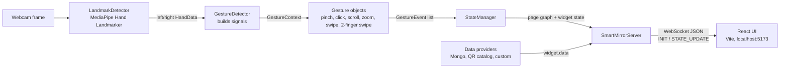

# Architecture

A local-first Python SDK for building a gesture-controlled smart mirror. A webcam watches the user's hands, a computer-vision pipeline turns hand movement into gesture events, a state manager uses those events to switch pages and control widgets, and a React UI renders the current state, which it receives over a WebSocket.

> To add your own gestures, widgets or pages, see [extending.md](extending.md). The backend ↔ frontend messages are in [protocol.md](protocol.md).

---

## 1. Architecture at a glance



**Runtime loop** (`SmartMirrorServer._main_loop`, fed by `server/camera.py`, roughly every 10 ms):

1. Read a camera frame and mirror it horizontally (`cv2.flip`).
2. `GestureDetector.process_frame(frame)` returns `{hands, signals, events}`. At most `camera_preview_fps` (10) times a second, `CameraPreview` sends a small annotated copy (hand boxes, pointer trails, pinch line) plus the latest gesture names as a `CAMERA_FRAME` message for the frontend's corner preview. Disable this with `SmartMirrorServer(camera_preview=False)`.
3. `StateManager.handle_gesture_events(events, signals)` returns `True` if the state changed.
4. If the state changed, broadcast a `STATE_UPDATE` with the state snapshot (the active page) to every WebSocket client.
5. Separately, every 0.5 s (`widget_update_tick`, in its own loop so a stalled camera can't hold it back), refresh widget data from each due `data_provider` on the active page and broadcast if any data changed.

---

## 2. Repository layout

```
Smart-Mirror-SDK/
├── backend/                       # Python: the SDK + the mirror app
│   ├── pyproject.toml, uv.lock
│   ├── .env.example               # every setting; copy to backend/.env
│   ├── smartmirror/               # the package
│   │   ├── app/                   # the mirror app (`python -m smartmirror`)
│   │   │   ├── main.py            # builds content sync, assistant, pages, server; runs them
│   │   │   ├── settings.py        # Settings.from_env(): every SMARTMIRROR_* / MONGO_URI variable
│   │   │   ├── pages.py           # the widgets and the page graph (games <-> home <-> events)
│   │   │   └── frontend_dev.py    # FrontendLauncher: npm install + Vite dev server (dev convenience)
│   │   ├── server/                # SmartMirrorServer and what it runs
│   │   │   ├── app.py             # SmartMirrorServer: starts the loops, per-frame work, event images
│   │   │   ├── camera.py          # Camera (local index or LAN stream, with reconnect) + frame-rate watchdog
│   │   │   ├── websocket.py       # ClientHub: connected clients, INIT + broadcasts
│   │   │   ├── camera_preview.py  # CameraPreview: small annotated webcam frame + latest gestures
│   │   │   ├── hand_pointer.py    # HandPointer: fingertip position for the frontend's cursor
│   │   │   └── widget_data.py     # Calls widget data providers on their refresh interval
│   │   ├── vision/                # Hand tracking + gestures (see vision.md)
│   │   │   ├── landmark_detector.py  gesture_detector.py  hand_data.py  gesture_types.py  debug_overlay.py
│   │   │   └── gestures/          # One gesture per file + default_set.py
│   │   ├── core/                  # StateManager, split by responsibility (mixins)
│   │   │   ├── state_manager.py   # dispatch, rate limiting, state snapshot
│   │   │   ├── navigation.py      # page graph
│   │   │   ├── actions.py         # app-level event_bindings
│   │   │   ├── widget_events.py   # widget.handle_gesture + default bindings (navigation, pinch-drag)
│   │   │   └── callables.py       # call_flexibly
│   │   ├── widgets/               # Python widget models (serialized to the frontend) + providers/
│   │   ├── assistant/             # Voice assistant: stt/ (VAD, wake word, Whisper), llm/, rag/, tts/, tools/
│   │   ├── content/               # Mongo -> cache + Qdrant sync of the club content (opt-in: MONGO_URI)
│   │   ├── hal/hal.py             # Audio I/O: local mic/speaker, or a mic streamed over the LAN
│   │   └── config/                # default JSON tunables + data_dir() (runtime files)
│   ├── tests/                     # pytest, one folder per package; no camera needed
│   ├── scripts/                   # lan_media_server, content_sync_daemon, run_supervised.sh, checks
│   └── examples/                  # gesture_detector_debug.py
├── frontend/                      # React + TypeScript + Vite
│   └── src/
│       ├── main.tsx, app/App.tsx
│       ├── mirror/                # MirrorCanvas (state + status) → PageView → WidgetSlot, cursor, preview
│       ├── widgets/               # One folder per widget type (index.ts = defineWidget(type, Component))
│       ├── assistant/             # The Abdo avatar
│       ├── services/useWebSocket.ts
│       └── types/mirror.ts        # Wire format (see protocol.md)
├── docs/
└── dev.sh                         # content-sync daemon + mirror app, see the root README
```

Runtime files (the downloaded hand-tracking model, the embedded Qdrant store, the
content cache) go in `backend/.data/` (`SMARTMIRROR_DATA_DIR` to move them), never in
the source tree.

---

## 3. Getting started

### Backend

```bash
cd backend
uv sync --extra data --extra assistant      # creates backend/.venv; drop the extras for gestures only
cp .env.example .env                         # optional: see the comments inside
```

Core dependencies: `mediapipe`, `opencv-python`, `websockets`, `numpy`. Extras: `data`
(`pymongo`, `python-dotenv`) and `assistant` (LLM clients, Qdrant, sentence-transformers,
Whisper, Piper). The MediaPipe model is downloaded into `backend/.data/models/` on first run.

### Run the mirror

```bash
cd backend
uv run python -m smartmirror
```

This does the following:
- Starts the WebSocket server on `ws://localhost:8080` (`SMARTMIRROR_WS_PORT`).
- Runs `npm install` (first time only) and `npm run dev` inside `frontend/`, which serves
  the UI at `http://localhost:5173` (`SMARTMIRROR_FRONTEND_PORT`). Node/npm must be on
  your PATH. Set `SMARTMIRROR_FRONTEND=0` to start the frontend yourself instead.
- Opens the default camera (`SMARTMIRROR_CAMERA`: an index or a LAN stream URL). If
  no camera is available, it falls back to a data-only mode.

Without `MONGO_URI`, the calendar, news and events widgets show placeholders and the
assistant answers from its seed corpus.

### Debug gestures only

```bash
cd backend
uv run python examples/gesture_detector_debug.py
```

This opens an annotated camera window showing bounding boxes, pointer trails, pinch span, zoom/scroll metrics and a live event feed. Press `q` to quit.

---

## 4. Computer vision pipeline (`smartmirror/vision`)

### 4.1 LandmarkDetector
- Wraps the MediaPipe Tasks `HandLandmarker` in `VIDEO` mode and tracks up to 2 hands.
- `extract_hands(frame)` always returns `{"left": HandData, "right": HandData}`. A hand that isn't detected is returned as an empty `HandData` (all fields `None` or `False`).
- `HandData` contains:
  - `landmarks`: 21 × `(x, y, z)`, normalized to 0–1.
  - `palm_center`: landmark 9.
  - `bbox`.
  - `is_raised`: `True` when the wrist's y is below 0.5, i.e. the wrist is in the upper half of the frame.

### 4.2 GestureDetector: shared signals
Per-frame features are computed once in `_build_signals` and shared by every gesture:

| Signal | Meaning |
|---|---|
| `hand_count`, `left_detected`, `right_detected` | Presence |
| `pinching[side]` | Thumb-to-index distance, with hysteresis: starts below 0.045, ends above 0.065 |
| `index_up`, `middle_up`, `ring_up`, `pinky_up` | Fingertip is above its PIP joint |
| `hover_posture` | Index and middle fingers up |
| `open_hand` | At least 3 of the 4 fingers up and not pinching |
| `pointer_position` | Index fingertip (falls back to palm center) |
| `pointer_delta`, `horizontal_delta`, `vertical_delta` | Frame-to-frame pointer movement |
| `thumb_index_distance` (+ `_delta`) | Pinch/zoom span |
| `zoom_mode_pinky_up`, `zoom_mode_no_pinky` | Span ≥ 0.08, not pinching, pinky up / pinky down |
| `both_hands_raised` | Both wrists in the upper half |

### 4.3 Gestures and events
Each gesture is a class with `detect(context) -> List[GestureEvent]`. A `GestureEvent` holds `type` (a `GestureType` or any string), `hand`, `location` and an optional `data` dict. `event.name` is the string used by bindings and edges.

| Gesture | Trigger | Events (`GestureType` value) |
|---|---|---|
| `PinchGesture` | Thumb and index pinch | `pinch_start`, `pinch_move` (`data: dx, dy`), `pinch_end` |
| `ClickGesture` | From hover posture, fold the index finger (left) or middle finger (right) | `left_click`, `right_click` |
| `ScrollGesture` | Hover posture + vertical movement ≥ 0.05 | `scroll_start`, `scroll_update`, `scroll_end` (`data: velocity_y`) |
| `ZoomGesture` | Open thumb-index span changing ≥ 0.025, in two modes (pinky up / pinky down) | `zoom_{start,update,end}_{pinky_up,no_pinky}` (`data: span_delta`) |
| `SwipeGesture` | One open hand, palm moves ≥ 0.12 quickly and consistently in one direction | `swipe_left/right/up/down` |
| `TwoFingersSwipeGesture` | One hand, only index and middle fingers up, same motion rules | `two_fingers_swipe_left/right/up/down` |

Both swipe gestures are built on `PostureSwipeGesture`: a warm-up after the posture is detected, a time window, a minimum velocity, a direction-consistency ratio (75%) and a cooldown. Scroll and zoom are built on `ContinuousGesture` (start → update → end). Because the frame is mirrored, moving your hand toward screen-left produces `*_swipe_right`.

To add a gesture from your own code (no enum edit needed), see [extending.md](extending.md#1-add-a-gesture).

---

## 5. State & navigation (`smartmirror/core/`)

### 5.1 The page graph
An app is described as a graph. Nodes are pages holding widgets, and edges are gesture-triggered transitions:

```python
graph = {
    "nodes": [
        {"id": "home",  "widgets": [weather, calendar, text]},
        {"id": "games", "widgets": [games]},
    ],
    "edges": [
        {"from": "home",  "to": "games", "gesture": "two_fingers_swipe_right"},
        {"from": "games", "to": "home",  "gesture": "two_fingers_swipe_left"},
    ],
}
```

Edge fields also accept `source`/`target` instead of `from`/`to`, and `trigger`/`event` instead of `gesture`.

### 5.2 Event dispatch order
For each event, `handle_gesture_events` stops at the first stage that changes state:

1. **Custom bindings** (`event_bindings` constructor arg). Each binding maps an event name to one or more actions: a callable, a `StateManager` method name, or `{"target": "state_manager" | "current_widget" | <attr>, "method": ..., "kwargs": ...}`. For example, `{"method": "set_current_node", "kwargs": {"node_id": "home"}}` jumps to a page.
2. **Graph navigation.** Follows an outgoing edge from the current node whose gesture matches the event. Rate-limited by `node_navigation_cooldown`.
3. **Widget events.**
   1. Widgets that list the event in their `gestures` get `handle_gesture(event)`: custom per-widget behavior.
   2. Otherwise the event is looked up in `default_widget_event_bindings.json`. Each binding has a `target` (`navigable`, `draggable`, `any` or `none`). The handler runs on the matching widget nearest `event.location` within `target_radius`; if none is that close, it runs on the page's first matching widget.

| Event | Handler | Target | Effect |
|---|---|---|---|
| `swipe_left/right` | `_handle_widget_navigation` | `navigable` | Next/previous item (±1 horizontal step) |
| `swipe_up/down` | `_handle_widget_navigation` | `navigable` | Previous/next section (±1 vertical step) |
| `scroll_start/update` | `_handle_widget_scroll` | `navigable` | ±1 vertical step if \|velocity_y\| ≥ `scroll_velocity_threshold` |
| `pinch_start` | `_handle_widget_drag_start` | `draggable` | Grab the nearest draggable widget (any type) |
| `pinch_move/end` | `_handle_widget_drag_move/_end` | `none` | Move the grabbed widget by `dx/dy` (clamped to 0–1), release it |

### 5.3 Tunables (`default_gesture_config.json`)

| Key | Default |
|---|---|
| `target_radius` | 0.35 |
| `swipe_cooldown` | 0.30 s |
| `scroll_cooldown` | 0.25 s |
| `node_navigation_cooldown` | 0.80 s |
| `scroll_velocity_threshold` | 0.03 |
| `allow_unmatched_single_edge_navigation` | false |

Override any of these through `StateManager(gesture_config={...})`. Widget bindings can be overridden the same way with `widget_event_bindings={...}`.

---

## 6. Widgets & data

### 6.1 Python widget models (`smartmirror/widgets`)
Every widget extends `BaseWidget`. A widget type is a subclass that sets `type` (plus optional `refresh_interval` and `gestures` class attributes). Constructor fields:
- `position` (`{"x": 0–1, "y": 0–1}`, a fraction of the screen)
- `content`, `data`, `metadata`
- `data_provider`, `refresh_interval`
- `gestures` (event names routed to `handle_gesture`), `draggable` (default `True`)
- `widget_id` (auto-generated as `<type>-<n>`), `widget_type` (for one-off widgets without a subclass)

`serialize()` produces the JSON sent to the UI: `id`, `type`, `position`, `content`, `data`, `metadata`, `draggable`, `dragging`.

| Class | `type` | Notes |
|---|---|---|
| `TextWidget` | `text` | `content` can be a string, a list (swipe left/right cycles items) or a dict of lists (swipe up/down changes section). Implements `apply_navigation`. |
| `CalendarWidget` | `calendar` | Expects `data = {"events": [...]}` |
| `QRGalleryWidget` | `qr_gallery` | Expects `data = {"categories": {name: [{title, imageUrl, url}]}}` |
| `GamesWidget` | `games` | Tiles for computer-vision games: `GamesWidget(games=[{id, title, icon}])`, `icon` an optional image URL |
| `EventsWidget` | `events` | Cards for club events/projects: `EventsWidget(items=[{id, name, description, image}])`, or a `data_provider` returning `{"items": [...]}` |
| `WeatherWidget` | `weather` | Current weather with a pixel icon; use `data_provider=OpenMeteoWeatherProvider(...)` |
| `NewsWidget` | `news` | Announcements/achievements (`data = {"items": [...]}`) or placeholder `content` |

### 6.2 Data providers (`smartmirror/widgets/providers`)
A data provider is any callable, sync or async, with the signature `provider(widget)` or `provider()`. The server calls it every `refresh_interval` seconds and stores the result in `widget.data`. Built-in providers:
- `MongoCalendarProvider(uri, database, collection, query, ...)` returns `{"events": [...]}`, with datetimes converted to ISO strings.
- `QRCodeCatalogProvider(categories)` returns `{"categories": ...}`.
- `OpenMeteoWeatherProvider(latitude, longitude, city)` returns the current weather from Open-Meteo (no API key): `{"city", "temperature", "humidity", "wind", "code", "isDay"}`.

---

## 7. Frontend (`frontend/`)

- React 19 + TypeScript + Vite 7. It talks to the backend only over the WebSocket; see [protocol.md](protocol.md).
- `mirror/MirrorCanvas.tsx` renders the active page. `WidgetSlot` looks each widget's `type` up in `widgets/registry.ts`, which auto-discovers every `widgets/<name>/index.ts` (`export default defineWidget('<type>', Component)`). Each widget is absolutely positioned at `position.x/y × 100%`. A status bar shows the connection state and the page. A widget that is being dragged gets the `widget-slot--dragging` class.
- `CAMERA_FRAME` shows as a small webcam preview in the top-right corner with the latest gestures under it (`mirror/CameraPreview.tsx`), `POINTER` drives the hand cursor (`mirror/HandCursor.tsx`), and the `ASSISTANT_*` messages drive the Abdo avatar (`assistant/Abdo.tsx`).

---

## 8. Tests

`cd backend && uv run pytest` runs the whole suite without a camera. Tests live in
`backend/tests/<package>/`. `tests/hands.py` builds synthetic hands, which are fed
through `GestureDetector.process_hands(..., timestamp=...)`.

- The assistant tests load the sentence-transformers model once per session (slow on the first run).
- The content tests that need a real Mongo read `MONGO_URI` and skip without one
  (`../Dashboard/dev.sh up` starts it).
- Tests write their Qdrant stores to a temporary `SMARTMIRROR_DATA_DIR`, never to `backend/.data`.

To check gestures live on a camera, use `examples/gesture_detector_debug.py`.

---

## 9. Current status & known gaps

**Working:** hand tracking, the six gesture types, custom gestures/widgets/pages from app code, page-graph navigation, `TextWidget` item/section navigation, pinch-drag of any draggable widget, pluggable data providers, the WebSocket state sync, the auto-launched React UI, the debug overlay, LAN camera/mic streams, and the Mongo content sync.

**Voice assistant:** `SmartMirrorServer(assistant=...)` runs `Assistant.listen_loop` when the assistant was built with `stt=True`: a heard question sends `ASSISTANT_HEARD` + `ASSISTANT_WAKE`, the answer sends `ASSISTANT_SAY` while TTS speaks it. See [voice-pipeline-testing.md](voice-pipeline-testing.md).

**Not wired yet**
- `ClickGesture` and `ZoomGesture` events are detected but have no default bindings. Use `event_bindings` or a widget's `gestures` to act on them.
- The React `WeatherWidget` and `NewsWidget` render static content and ignore `data`.
- The protocol is one-way: client messages are only logged.

**Pinch & drag**
- When no draggable widget is within `target_radius`, the resolver falls back to the page's first draggable widget, so a pinch anywhere grabs something. Set `draggable=False` on widgets that should stay put.
- Pinch coordinates are in camera space (normalized and mirrored), while widget positions are in screen space. The code treats the two as the same space, and no calibration is applied.

---

## 10. Minimal app template

```python
import asyncio
from smartmirror.server import SmartMirrorServer
from smartmirror.core import StateManager
from smartmirror.widgets import TextWidget

home = TextWidget(position={"x": 0.5, "y": 0.5},
                  content={"tips": ["Swipe to cycle", "Scroll for sections"],
                           "about": ["Smart Mirror SDK"]})
graph = {"nodes": [{"id": "home", "widgets": [home]}], "edges": []}

server = SmartMirrorServer(state_manager=StateManager(graph=graph))  # or SmartMirrorServer(graph=graph)
# The frontend connects on its own: cd frontend && npm run dev
asyncio.run(server.run())
```

Next steps: [extending.md](extending.md) covers adding your own gestures, widgets and pages.
